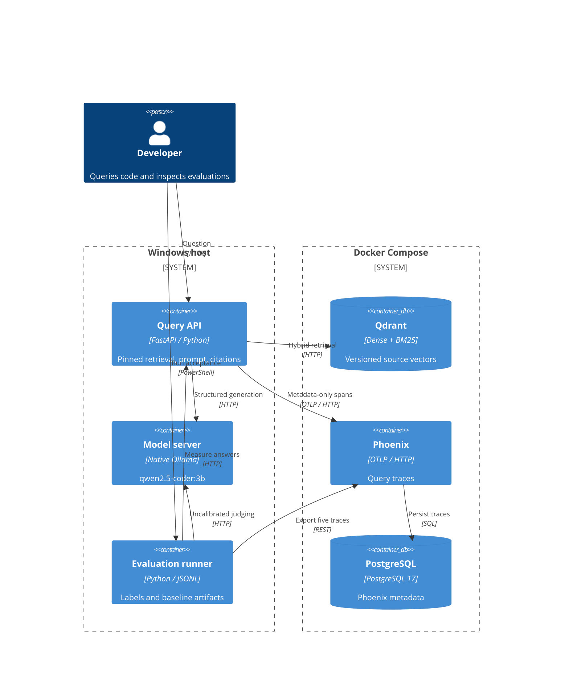

# Architecture v1

Container view of the implemented demo. Host ports bind to loopback. The API uses
one worker and one nonblocking generation slot. Ollama runs natively; the storage
and tracing services use the accepted Compose stack.

Git ingestion publishes immutable corpus JSONL and hash-checked manifests.
CPU embeddings publish dense/BM25 vectors and a versioned index manifest. The API
verifies chunks against the corpus, selects whole chunks in RRF order, requests
sourced statements, validates labels, and renders citations.

The `rerank` span records `enabled=false` and `preserve_rrf_order`, describing the
pass-through/context-budget stage. No learned reranker is deployed. PostgreSQL's
`copilot` database is reserved for later application metadata; current application
versions are kept in manifests, not claimed to be in SQL.

Trace attributes include versions, chunk IDs/locations, timings, and token counts.
Raw questions, source text, model output, and exception stacks are omitted.
Phoenix outages do not fail queries. The exporter has bounded buffers and can
drop spans; acceptance separately checks collector ingestion and readback.

Authentication/rate limiting, LiteLLM, vLLM, GPU capacity tests, Kubernetes,
canary delivery, and production SLOs remain later-week work.
